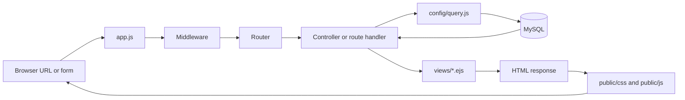

# FINDBACK Code Walkthrough for Beginners

This guide explains how to read the project, how a browser request travels through it, and how the user profile, items, and chat pages connect. The existing guides in this folder cover setup, database tables, authentication, and other page families. This guide is a beginner-friendly map from code to code.

> Read secrets from your own private `.env` file when setting up the project. Never paste its contents into documentation, screenshots, or chat.

## 1. Start with the request path

A route is the address and HTTP method, such as `GET /user/profile`. A handler is the function that responds to that route. For a page request, the handler usually reads session data, queries MySQL, then calls `res.render()` with a view name and an object of values. EJS combines those values with HTML. The browser receives HTML and then loads the linked CSS, images, and JavaScript.

## 2. JavaScript and Express syntax used in this project

- `const name = ...` creates a variable that cannot be assigned a different value later. Objects held by a `const` can still have their properties changed.
- `require("./file")` loads another CommonJS module. `./` means a nearby file; `../` means go up one directory. For example, `require("../config/query")` from `controllers/` loads `config/query.js`.
- `module.exports = value` makes a value available to files that call `require()`. `exports.someName = fn` exports one named function.
- `const { a, b } = object` is destructuring: it copies named properties into local variables.
- `(req, res, next) => { ... }` is an arrow function. Express calls it with the request, response, and a `next` function. Calling `next()` passes control to the next middleware/handler.
- `async` marks a function that can wait for asynchronous work. `await` pauses that function until a Promise completes; it does not block the whole Node.js server.
- `return res.redirect(...)` sends a redirect and exits the current handler. The `return` prevents later code in that handler from also running.
- `req.params` contains pieces of the URL such as `:id`; `req.body` contains submitted form/JSON fields; `req.query` contains `?key=value` values; `req.session` contains server-side session data.
- `?` in SQL paired with a parameter array is a placeholder. `query("... WHERE user_id = ?", [userId])` keeps the value separate from SQL text and helps prevent SQL injection.
- `try { ... } catch (error) { ... }` handles errors from awaited database or other operations.

## 3. EJS and HTML syntax

The main profile page is [views/user/user-profile.ejs](../views/user/user-profile.ejs). EJS runs on the server before the browser sees the page.

- `<% JavaScript %>` runs JavaScript without printing it. It is used for `if`, loops, and local helper functions.
- `<%= value %>` prints a value with HTML escaping. Use this for names, statuses, and other text so characters like `<` are not treated as HTML.
- `<%- value %>` prints raw HTML. This project uses it for trusted EJS partials and prepared SVG markup. Avoid using it for untrusted user input.
- `<%# comment %>` is an EJS comment; it is removed from the rendered output.
- HTML attributes such as `class`, `href`, `src`, and `aria-label` describe an element. A `class` name connects the HTML to CSS selectors. An `href` connects a link to an Express route. A `src` connects an image/script to a static path served from `public/`.
- `include("partials/user-header", {...})` renders a reusable EJS partial and passes it values. The user header itself includes the navbar partial.

## 4. User profile, step by step

### 4.1 Route and controller data

[routers/userprofile-router.js](../routers/userprofile-router.js) defines `GET /profile`. `app.js` mounts that router at `/user`, so the complete browser URL is `/user/profile`.

The route first runs `authMiddleware`. That middleware checks for a user in `req.session`; guests are redirected to login. The handler takes `user_id` from that session, not from a browser form field. It selects safe profile columns (the query does not request the password hash), then loads that user's found items, lost items, and claims. `Promise.all([...])` starts the independent queries together and waits for all of them.

The local `shape(item, type)` changes two different database row shapes into one shared display shape. The route combines the mapped lost and found records, sorts newest first, and limits the profile preview to six. It renders `user/user-profile` with these locals:

- `user`: the selected profile record.
- `stats`: counts for found, lost, all claims, and verified claims.
- `claims`: the newest five claims.
- `items`: the newest six combined lost/found records.

`res.render("user/user-profile", {...})` resolves to `views/user/user-profile.ejs`. If the query/render preparation throws, the `catch` logs the error, adds a flash message, and redirects.

### 4.2 Template setup block

At the top of the EJS file, a server-side code block prepares small display helpers:

- `initial` takes the first character of the user's name and uppercases it; it is the avatar fallback.
- `fmtDate(value)` turns a stored date into a short Philippine-locale date, or a dash for a missing date.
- `claimBadge` and `claimLabel` map database claim statuses to CSS badge names and friendlier words.
- `accountBadge(status)` maps active/inactive account state to a success/danger class.
- `verifyBadge` maps verification status to a badge class.

These helpers only format values for this page. They do not update the database.

### 4.3 Document head and stylesheets

The `<head>` sets the UTF-8 encoding and viewport width, browser title, site icon, and font links. The two local style links load `/css/user/user-ui.css` first and `/css/user/user-shell.css` second. Express serves those URLs from `public/`. The second stylesheet supplies the account shell and the profile/items components; the user header partial also links the site navbar styles. The order matters when two CSS rules have the same specificity: a later rule can override an earlier one.

### 4.4 Shared header and flash messages

The template includes `partials/user-header` with `{ user, activePage: 'profile' }`. That partial renders the navbar, welcome hero, and account tabs; `activePage` marks Profile as selected.

The `success` and `error` sections use a conditional fallback (`typeof ... !== 'undefined' ? ... : []`) so the template can safely render even if middleware did not create a local. `forEach` repeats one alert element per message. `<%= msg %>` escapes each message.

### 4.5 Heading and Edit Profile link

The page heading describes the screen. The Edit Profile anchor has `href="/user/profile/edit"`, which maps to the edit-page GET route in `userprofile-router.js`. Its SVG is inline markup; the `.ico` class lets CSS set a predictable icon size. The button is only a link to the edit form; it does not update profile data itself.

### 4.6 Summary cards

The `stats` section contains four cards. Each `<%= stats.found %>`-style expression reads one property from the object sent by the controller. The SVGs are decorative icons. Classes such as `stat`, `stat-icon`, `warn`, and `ok` are styling hooks defined in the shared user-shell stylesheet.

### 4.7 Personal information and identity card

The first panel uses a definition list: each `<dt>` is a label and its following `<dd>` is the value. The `||` operator supplies fallback text when the value is empty or missing. Inline `<%= ... %>` expressions are escaped output. Status fields call the formatting helpers and insert the returned class into `class="badge ..."`.

The second panel uses an EJS `if/else`: if `user.profile_image` exists, render an ``; otherwise, render the first initial. The name, email, role, and account status are printed below it. Both edit links point to the same GET route.

### 4.8 Claim history

`if (claims.length)` checks whether the array has records. When it does, the template creates a table and `claims.forEach(function (c) { ... })` writes one row per claim. `c` is the loop's current row. Date helpers format submission/review dates; status maps produce the label and badge. The View Claim link includes `c.claim_id` in the URL, matching `/user/claims/:id`.

A nested condition compares total claims (`stats.claims`) with displayed claims (`claims.length`). If there are more, a note says that only the latest five are shown. The `else` branch displays the no-claims message.

### 4.9 Reported items

The items panel links to `/user/items` for the full list. If there are records, `items.forEach` builds a list row for each object. The ternary operator (`condition ? valueA : valueB`) selects the lost/found badge color. Another conditional adds a status badge only when the record has a status. Category, location, and date are optional display pieces. If there are no records, the `else` branch shows a friendly empty state.

## 5. Edit profile and items pages

[views/user/profile_edit.ejs](../views/user/profile_edit.ejs) uses the same `user-ui.css`, `user-shell.css`, and shared user header. Its form submits `POST /user/profile/update` with `multipart/form-data`, because the form can include an image file. The `name` attributes `full_name`, `contact_number`, and `profile_image` are the keys the route reads from `req.body`/Multer. The email field is disabled because the backend does not update it.

[routers/userprofile-router.js](../routers/userprofile-router.js) handles the POST. It checks required values and lengths, conditionally adds an image path to the SQL update, updates the session copy of the profile fields, flashes a result, and redirects to `/user/profile`. The template's browser script previews a selected image with `URL.createObjectURL`; that preview is temporary and is not the saved database image until the form is submitted successfully.

[views/user/items.ejs](../views/user/items.ejs) receives `items` and `stats` from `GET /user/items`. It renders summary cards, filter buttons, and a table. Each row has `data-type="lost"` or `data-type="found"`. The small inline browser script listens for chip clicks, compares the selected filter with each row's `data-type`, toggles the row's `hidden` property, and displays the empty notice if the filter matches no row. This filtering is only in the current browser page; it does not query MySQL again.

## 6. Chat page and live chat code

[views/user/chat.ejs](../views/user/chat.ejs) creates the page skeleton. The root `#chat` element has `data-me`, `data-open`, and `data-draft` attributes; EJS fills them with the current user ID, optional conversation ID, and optional prefilled text. Browser JavaScript reads them through `element.dataset`.

The left `<aside>` contains the conversation search input and `#chatList`, initially showing a loading message. The right section has two states: `#chatEmpty` when no conversation is open, and hidden `#chatThread` after selection. The thread contains the contact header, message list, error region, and send form. IDs are hooks that `public/js/chat.js` looks up with `getElementById`.

The page loads `/socket.io/socket.io.js` (the Socket.IO browser client served by the running server) and `/js/chat.js` (the project's page script). `defer` means the browser waits to execute the local script until HTML parsing is complete.

`public/js/chat.js` is an immediately invoked function expression (IIFE): `(function () { ... })();` creates a private scope so its variables do not become global variables. It fetches the chat APIs mounted by `routers/userchat-router.js`, creates message elements with `textContent` to avoid interpreting user messages as HTML, and uses Socket.IO for live updates. Persistent messages/read markers live in MySQL through `controllers/user-chat-controller.js`; sockets provide live notifications of changes. The API still checks the session and verifies conversation participation on the server.

[public/css/user/chat.css](../public/css/user/chat.css) styles the chat layout and class names produced by `chat.js`. The conversation list, message bubbles, composer, and read receipts use theme variables. The search SVG is explicitly sized in the left panel so an inline SVG cannot expand to its browser default dimensions. At narrow widths, the CSS displays one pane at a time and the Back button returns to the conversation list.

## 7. Database helper files and connections

- [config/db.js](../config/db.js) loads `.env`, creates the `mysql2` connection pool from `DB_HOST`, `DB_USER`, `DB_PASSWORD`, and `DB_NAME`, performs a startup connection check, and exports the pool. The real secret values must remain private.
- [config/query.js](../config/query.js) wraps `db.query` in a Promise. This lets route/controller code use `await query(sql, params)` instead of nested callback functions.
- `routers/userprofile-router.js` imports both `db.js` and `query.js`: profile/items use the Promise helper, while edit/read/update uses callback-style `db.query` in existing code.
- Parameter arrays such as `[userId]` fill SQL `?` placeholders. Do not build SQL by concatenating untrusted form fields.

## 8. Other important source files by responsibility

### Application setup and shared configuration

- [app.js](../app.js) loads environment settings; creates Express, HTTP, and Socket.IO servers; applies security and body parsers; sets up the shared session and flash messages; serves `public/`; configures EJS; attaches common locals/theme/bell; mounts routers; and listens on port 4000.
- [config/password.js](../config/password.js) contains password hashing/verification and strength helpers used by `controllers/secure-auth.js` and admin account handlers.
- [config/theme.js](../config/theme.js) validates theme settings and produces the script used to apply them.
- [config/notify.js](../config/notify.js) writes notifications to MySQL and emits live notification events. [config/global-bell.js](../config/global-bell.js) provides notification markup injected by `app.js`.
- [config/admin-ui.js](../config/admin-ui.js) supplies admin view helpers for icons, escaping, avatars, dates, badges, and activity labels.

### Middleware

Middleware runs between the incoming request and a route. `next()` continues the chain; a redirect or response ends it.

- [middleware/security.js](../middleware/security.js) applies security headers and no-store behavior.
- [middleware/csrf.js](../middleware/csrf.js) prepares and verifies session-based CSRF tokens for protected forms.
- [middleware/auth-middleware.js](../middleware/auth-middleware.js) requires a signed-in user.
- [middleware/admin-middleware.js](../middleware/admin-middleware.js) provides admin template locals and checks admin authorization/active status.
- [middleware/upload-middleware.js](../middleware/upload-middleware.js) configures image upload parsing and validation.
- [middleware/user-middleware.js](../middleware/user-middleware.js) makes session user data available to views.
- [middleware/user-theme.js](../middleware/user-theme.js) loads/applies the signed-in user's theme.
- [middleware/admin-activity.js](../middleware/admin-activity.js) records admin actions where called.

### Routers and handlers

`app.js` mounts routers with a prefix. The router's path is appended to that prefix. For example `app.use("/user", userprofileRouter)` plus `router.get("/profile", ...)` becomes `GET /user/profile`.

- [routers/landing-router.js](../routers/landing-router.js): public landing, browse, info, and category pages.
- [routers/auth-router.js](../routers/auth-router.js) plus [controllers/secure-auth.js](../controllers/secure-auth.js): login/register/logout routes, rate limits, validation, password checks, session regeneration, redirects.
- [routers/lostItem-router.js](../routers/lostItem-router.js) and [routers/foundItem-router.js](../routers/foundItem-router.js): report forms and inserts.
- [routers/claim-router.js](../routers/claim-router.js) and [controllers/admin-claims-controller.js](../controllers/admin-claims-controller.js): user claim submission and admin claim review.
- [routers/feedback-router.js](../routers/feedback-router.js): authenticated feedback submissions.
- [routers/userprofile-router.js](../routers/userprofile-router.js): profile, profile edit, items list.
- [routers/usersettings-router.js](../routers/usersettings-router.js): user theme and account deletion routes.
- [routers/userchat-router.js](../routers/userchat-router.js) plus [controllers/user-chat-controller.js](../controllers/user-chat-controller.js): chat HTML page and conversation/message/read APIs.
- [routers/notification-router.js](../routers/notification-router.js) plus [controllers/user-notifications-controller.js](../controllers/user-notifications-controller.js): notification HTML/API operations.
- [routers/user-claims-router.js](../routers/user-claims-router.js) plus [controllers/user-claims-controller.js](../controllers/user-claims-controller.js): the signed-in user's claim list/details.
- [routers/admin-router.js](../routers/admin-router.js) plus [controllers/admin-controller.js](../controllers/admin-controller.js): admin dashboard and management routes. `controllers/admin-extras-controller.js` contains alternate handlers; verify the router wiring before assuming those handlers run.

### Views and browser assets

- `views/` contains EJS templates. `views/partials/`, `views/user/partials/`, and `views/admin/partials/` contain reusable fragments. Use `res.render()` names and `include()` calls to find which template is used.
- `public/css/` contains stylesheets. CSS selector names connect rules to HTML `class`/`id` attributes. `@media` blocks change styles for particular screen widths. CSS custom properties start with `--` and are read with `var(--name)`.
- `public/js/` contains browser-side behavior, such as admin interactions, chat, notifications, and theme controls. Browser code calls route APIs with `fetch()` and updates the DOM.
- `public/img/` contains static icons/images; `/img/example.png` is a URL relative to Express's `public/` static root.
- `sql/` and `findback.sql` contain schema/migration artifacts. They describe expected DB structures; the application code does not automatically run those SQL files as migrations.

## 9. Follow a connection yourself

To trace any page or action, search in this order:

1. Find the `app.use(prefix, require("./routers/..."))` line in `app.js`.
2. Add the router's `router.get/post/patch(...)` path to that prefix.
3. Read the middleware listed before the handler; it may authenticate, parse uploads, or validate CSRF.
4. Follow the handler/controller function. Note where it reads `req.session`, `req.params`, `req.body`, or `req.query`.
5. Follow imported helpers such as `query`, `notifyUser`, or `hashPassword` to their `config/` module.
6. For HTML, follow `res.render("...", locals)` to `views/...ejs`. For JSON, follow `res.json(...)` to the browser `fetch()` call.
7. Follow each template's CSS `<link>` and `<script>` URLs into `public/`.

## 10. Things this walkthrough does not claim

The guide describes runtime source and SQL files in the repository. It does not claim that migrations have been applied to a live MySQL server, that every optional feature is complete, or that unreferenced/legacy files are active. Consult `DATABASE_GUIDE.md` for schema mismatches and unresolved setup questions. No password, API key, session secret, or `.env` value belongs in this guide.

## 11. Route and handler map

`GET` normally reads a page or data. `POST` normally submits/creates data. `PATCH` normally changes part of an existing record. The exact routes below are assembled from the mount prefixes in `app.js` and the paths inside the router files.

| URL area | Router and handler | What it connects to |
|---|---|---|
| `/` and public pages | `routers/landing-router.js` | Renders home, browse, contact, how-it-works, and category EJS templates. Category handlers query lost/found tables and map the rows into a common listing format. |
| `/auth/login`, `/auth/register`, `/auth/logout` | `routers/auth-router.js` → `controllers/secure-auth.js` | CSRF/rate-limit/upload middleware runs before the login/register handlers. Handlers validate values, query users, hash/verify passwords, set/destroy sessions, then render or redirect. |
| `/lost` and `/found` | `routers/lostItem-router.js`, `routers/foundItem-router.js` | Authenticated report forms; POST handlers parse and validate form fields/photo, insert with the session user's ID, flash a result, then redirect. |
| `/claim/:type/:item_id` | `routers/claim-router.js` | Shows/submits claims for found items. It checks the target item and current user, prevents invalid/self/duplicate claims, inserts the pending claim, then emits the claim event. |
| `/fb/feedback` | `routers/feedback-router.js` | Saves feedback associated with the signed-in user. |
| `/user/profile`, `/user/profile/edit`, `/user/profile/update`, `/user/items` | `routers/userprofile-router.js` | Loads safe account data, edits profile fields/photo, or combines that user's lost/found records for the profile/items templates. |
| `/user/settings` | `routers/usersettings-router.js` | Renders settings, saves allowlisted theme choices, and runs the password-confirmed account deletion flow. |
| `/user/chat` and `/user/chat/api/...` | `routers/userchat-router.js` → `controllers/user-chat-controller.js` | Renders the chat page or serves conversation/message/read JSON. API handlers use the session user and check conversation participation before reading/writing. `public/js/chat.js` calls these endpoints. |
| `/user/notifications` and `/user/notifications/api/...` | `routers/notification-router.js` → `controllers/user-notifications-controller.js` | Renders notification page and provides list/count/read JSON endpoints. The browser notification script calls those API URLs. |
| `/user/claims` and `/user/claims/:id` | `routers/user-claims-router.js` → `controllers/user-claims-controller.js` | Lists claims and shows one claim only when it belongs to the signed-in user. |
| `/admin/...` | `routers/admin-router.js` → `controllers/admin-controller.js` and `controllers/admin-claims-controller.js` | Public admin bootstrap/login routes come before the admin guard. Management routes run after that guard. Claim list/status use the separate admin claims controller. |

### Admin handler groups

`controllers/admin-controller.js` exports the handlers connected by `admin-router.js`:

- `getLogin` and `login` redirect old admin login URLs to the shared secure auth endpoints.
- `getRegister` and `register` support creation of the first admin when none exists.
- `logout` ends the admin session.
- `getDashboard` loads dashboard summary data.
- `getUsers` lists users; `updateUserStatus` changes an account's active state.
- `getLostItems` and `getFoundItems` reuse the shared item loader/renderer with different item types.
- `getUserVerification` lists verification records; `updateVerificationStatus` changes review state.
- `getAnalytics` and `getReports` build admin summary/report pages.
- `getActivityLogs` loads admin audit rows.
- `getSettings`, `addAdmin`, and `updateAdminStatus` support admin management/settings.
- `getProfile`, `updateProfile`, and `changePassword` handle the current admin account.
- `notFound` renders the admin-specific not-found/error view for unmatched admin paths.

`controllers/admin-claims-controller.js` has two key handlers. `getClaims` selects claim, item, claimant, finder, and category information for the review page. `updateClaimStatus` validates the requested status and IDs, uses a database transaction/row locks for related updates, writes notification data, commits, and emits the live update.

`controllers/admin-extras-controller.js` contains additional settings/admin/activity handlers. The current `admin-router.js` imports `admin-controller.js`, so do not assume these extra handlers are active unless a route explicitly imports them.

### User handler groups

- `controllers/secure-auth.js`: `getLogin`/`getRegister` render forms; `login`/`register` process submissions; `logout` ends the session. The module also exports login and registration limiters used by `auth-router.js`.
- `controllers/user-chat-controller.js`: `getChatPage` renders the skeleton; `startConversation` resolves/creates a conversation; `listConversations` and `unreadCount` provide list/count data; `getMessages` pages messages; `sendMessage` stores and emits a message; `markRead` stores the participant's read marker and emits a read event.
- `controllers/user-notifications-controller.js`: `getNotifications` renders the page; `listApi` returns notifications; `unreadCountApi` returns a count; `markOneRead` and `markAllRead` update read state.
- `controllers/user-claims-controller.js`: `listClaims` renders the signed-in user's claim list; `viewClaim` loads an owned claim by ID and returns not-found when it is absent/not owned.
- `routers/userprofile-router.js` itself contains handlers for profile read, edit form read, profile update, and the user's all-items page.

## 12. File-to-file reading map

- `app.js` → each `routers/*.js` mount → route handler/controller → `config/query.js` or `config/db.js` → MySQL → `views/*.ejs` or `res.json()`.
- `views/user/user-profile.ejs` → `routers/userprofile-router.js` locals → `views/user/partials/user-header.ejs` → `views/user/partials/navbar.ejs` → `public/css/user/site-nav.css` and `public/css/user/user-shell.css`.
- `views/user/items.ejs` → `/user/items` route → local filter script changes rows in the current HTML; it does not make a second database request.
- `views/user/chat.ejs` → `/user/chat` page route → `public/js/chat.js` → `/user/chat/api/*` routes → `controllers/user-chat-controller.js` → MySQL and Socket.IO events.
- `views/user/profile_edit.ejs` → `POST /user/profile/update` → upload middleware → user profile update query → session refresh → redirect to the profile page.
- `views/user/settings.ejs` → `public/js/theme.js` for browser controls → `/user/settings/theme` API → `routers/usersettings-router.js` → theme DB columns and `config/theme.js`.
- `public/js/notify.js` → notification API routes; `config/notify.js` persists and emits notification events; `config/global-bell.js` supplies the shared bell markup.
- `views/admin/*.ejs` → `routers/admin-router.js` → admin guard and controller → `config/admin-ui.js` helpers and admin CSS/JS under `public/`.

A file can exist without being active. Confirm activity by finding its import/`require()`, a route that calls its export, a template `include()`, or an asset `<link>`/`<script>` reference. This is especially important for old templates, duplicate controllers, and legacy scripts.
