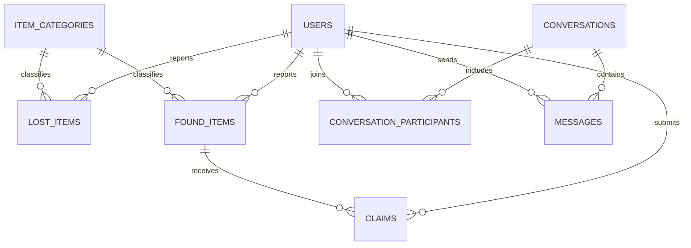

# Database Guide

## Connection
config/db.js reads DB_HOST (default localhost), DB_USER, DB_PASSWORD, DB_NAME (default copy) and creates mysql2 pool. query.js is a Promise wrapper. Pass data using ? placeholders.

## Tables and relationships
findback.sql defines users, item_categories, lost_items, found_items, item_images, claims, conversations, conversation_participants, messages and feedback. claims-update.sql creates notifications; admin-update.sql creates admin_activity_logs.
- users own lost/found reports, claims, feedback, notifications and chat participation/messages.
- item_categories classify lost/found items.
- claims connect a user to a found item.
- conversations connect users through conversation_participants; messages link conversation and sender.
- item_images optionally references lost or found item; current upload code instead stores one photo_path directly.
- notifications may reference user, found item, claim and related user after extension migration.

Queries: category routes query both item tables; profile routes filter by session user; claim detail filters claim_id and user_id; admin joins item/claimant/finder/category. Notification reads/writes use session user_id. Chat checks participant membership. Claim review uses transaction/row locks. Images reside on disk; DB stores paths.

## SQL and dependency
findback.sql is schema plus seed rows. claims-update.sql adds reviewed_by/reviewed_at/admin_note and notifications. user-theme-notifications.sql extends notifications. chat.sql adds last_read_message_id and message index. admin-update.sql creates activity table. user-theme.sql adds theme_mode/theme_color after verification_status. No migration runner; some ALTERs are one-time.

## Gaps to resolve
Base users schema lacks runtime fields verification_status, failed_login_attempts, locked_until, last_login_at. No listed migration adds these. user-theme.sql assumes verification_status exists. Theme, claim review, chat, and notification fields require migrations. Runtime uses item status claimed while migration comment says reserved. findback.sql contains seed records; review/remove before sharing/import as clean schema. No live DB was inspected or changed.
