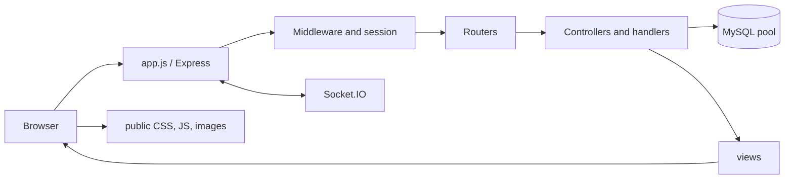

# Project Overview

## Purpose and stack
FINDBACK is a server-rendered lost-and-found system. Users report lost/found items, browse listings, claim found items, and manage profile, claims, notifications, chat, and appearance. Admins manage users/items and review claims. Runtime stack: Node.js, Express 5, EJS, MySQL, HTML/CSS/JavaScript, express-session, Socket.IO, and Multer.

## Status
Implemented in source: public home/browse/category/info pages; registration/login/logout; lost/found submissions; claims for found items; admin claim review; user profile/items/claims/notifications/chat/theme/account deletion; admin user/item/report/settings/log pages; image uploads; Socket.IO live updates.

Partial/conditional: verification fields and admin review exist, but no complete email delivery/verification workflow was found (nodemailer is installed but not wired); migrations are needed for theme, chat read state, claim review, notification extensions, and admin logs; session storage uses default MemoryStore.

Not verified/planned: root README explicitly calls its list planned. No password-reset or lost-item claim flow was found. Claims are restricted to found items in code.

## Architecture
app.js orders security, body parsing, session, flash, static serving, locals/theme and routes; route handlers query MySQL then render EJS, redirect, or return JSON. public/ is the static root. Socket.IO shares the session and emits live events; MySQL holds durable records.
