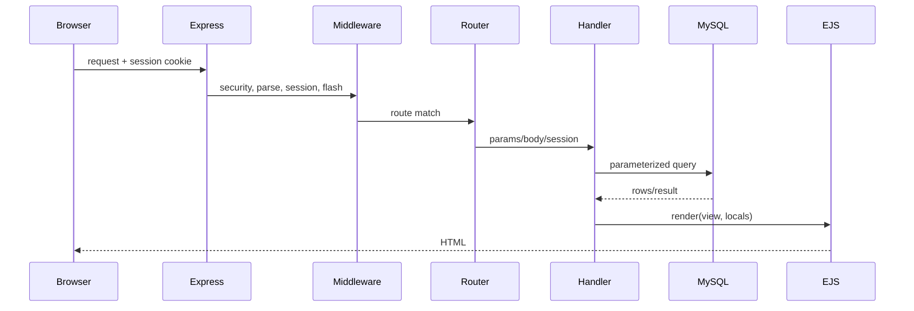
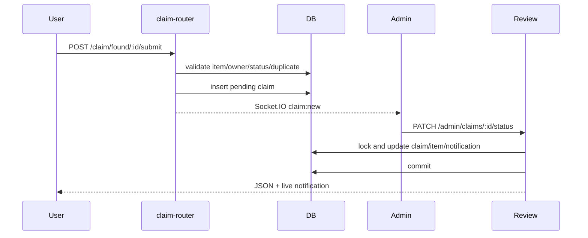

# Request Flow

## Lost/found
GET /lost or /found checks login and renders form. POST /lost/submit or /found/submit runs auth then Multer, validates name/category/photo/location/date, uses session user_id, stores photo path and inserts, then flashes/redirects.

## Claim review

Approval sets found_items.status to claimed in controller; claims-update.sql comment says reserved.

## Login and admin
POST /auth/login is limited and CSRF-checked. Controller checks account/password, updates lock fields, regenerates session, saves identity/role, redirects by role. admin-router leaves login/bootstrap public then applies requireAdmin to following routes; guard rechecks role and active status in MySQL.

## Chat/notifications
public/js/chat.js and notify.js call JSON APIs. Handlers get identity from session, validate conversation/notification ownership, access MySQL, then emit to server-derived private Socket.IO rooms. EJS renders initial pages; browser JS updates live state.
